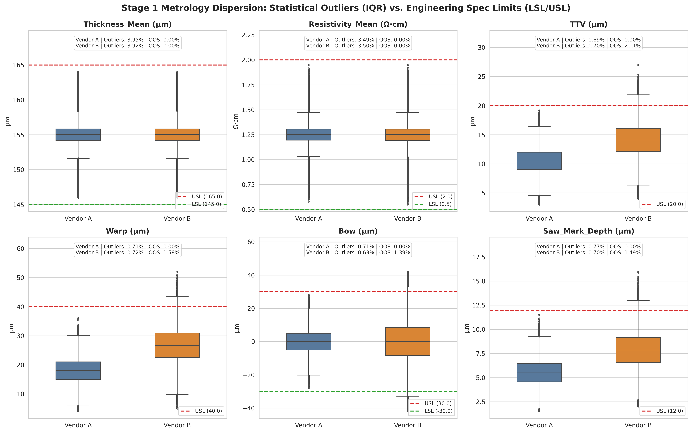
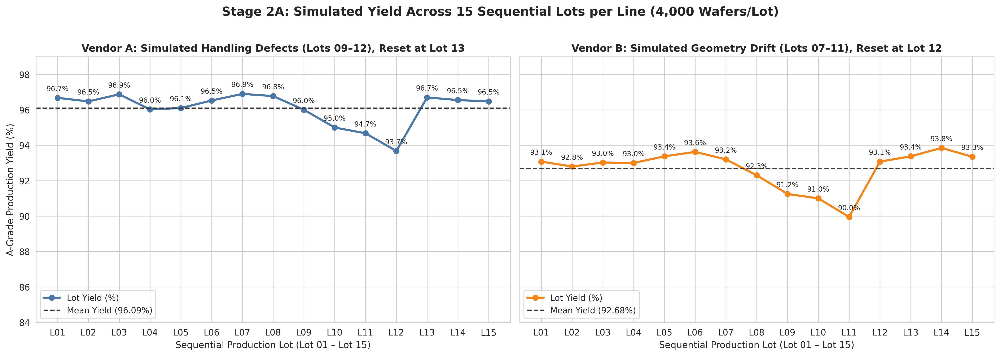
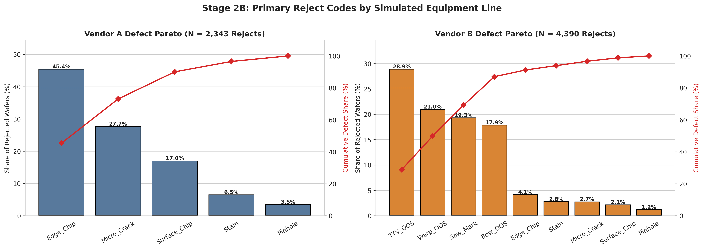
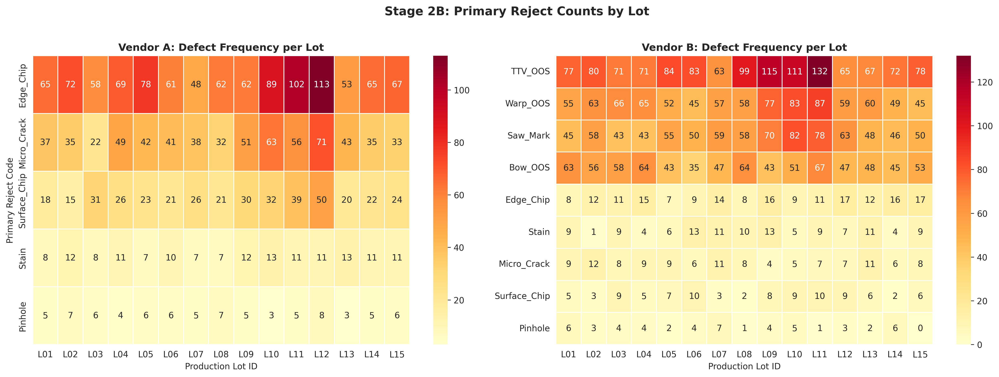

# A Two-Stage Method for Diagnosing Yield Loss in U.S. Solar Wafer Manufacturing

**Metrology and Lot-Level Defect Analysis on a Synthetic Benchmark**

[](https://www.python.org/downloads/)
[](https://opensource.org/licenses/MIT)
[](#governing-metrology-standards)

---

## Overview

A solar wafer line can meet its dimensional specifications and still lose yield to chips and cracks. A wafer can also breach a specification while falling within the range an outlier screen treats as typical for the line. This project demonstrates a two-stage workflow for deciding where to investigate these losses.

The benchmark contains **120,000 simulated M10 silicon wafers** across **30 lots** on two equipment lines, labeled Vendor A and Vendor B in the data. Stage 1 compares statistical outliers with benchmark specification limits. Stage 2 tracks A-grade yield and primary reject codes by lot. The settings and grade labels are simulated. The results illustrate how to prioritize checks in a plant investigation.

---

## Repository Structure

```text
wafer-spc-defect-attribution/
├── data/
│   └── wafer_metrology_120k.csv
├── figures/
│   ├── fig1_iqr_vs_spec_boxplots.png
│   ├── fig2_longitudinal_lot_yield.png
│   ├── fig3_defect_pareto_comparison.png
│   └── fig4_lot_defect_heatmaps.png
├── src/
│   ├── generate_wafer_metrology.py
│   └── analyze_wafer_spc.py
├── requirements.txt
└── README.md
```

---

## Data and Grading

The generator creates 15 lots of 4,000 wafers per line using random seed 42. **`PASS` denotes an A-grade wafer** that meets the benchmark limits and triggers no reject condition. The generator grades the complete simulated inspection record before rounding and masking exported measurements. Blank readings model possible sensor faults or network interruptions, so a blank can appear alongside a previously assigned grade.

The raw export has **120,480 rows**, including 480 exact duplicates that simulate inspection retries. After deduplication, **5,659 of 120,000 unique wafers (4.72%)** have at least one missing reading. Each of the eight affected channels has **720 missing values (0.60%)**.

| Measurement group | CSV columns | Benchmark acceptance limits |
| --- | --- | --- |
| Outer geometry | `Side_Length_*`, `Diagonal_*`, `Corner_Angle_*` | Side length 182.00 ± 0.25 mm, diagonal 247.00 ± 0.50 mm, corner angle 90.00° ± 0.30° |
| Thickness and resistivity | `Thickness_Mean`, `Resistivity_Mean` | 145.0–165.0 µm and 0.50–2.00 Ω·cm |
| Flatness and slicing | `TTV`, `Warp`, `Bow`, `Saw_Mark_Depth` | TTV ≤ 20 µm, warp ≤ 40 µm, absolute bow ≤ 30 µm, saw-mark depth ≤ 12 µm |
| Defect counts | `Edge_Chip_Count`, `Micro_Crack_Count`, `Surface_Chip_Count`, `Stain_Count`, `Pinhole_Count` | Up to two minor edge chips. Micro-crack, surface chip, stain, and pinhole counts must each be zero. |

`Time_Log`, `Vendor_ID`, and `Lot_ID` identify the inspection record. Chamfer lengths and the recorded thickness and resistivity minima and maxima are included for context. For wafers with multiple failed checks, `Sorting_Result` stores the first applicable code in this order: micro-crack, edge chip, surface chip, TTV, warp, bow, saw mark, stain, pinhole, then the remaining thickness, resistivity, and outer geometry checks.

## Stage 1 — Compare Outliers with Specification Breaches

For each metric and line, the analysis uses the available readings to calculate IQR fences and check the lower and upper specification limits (LSL and USL). It evaluates the two flags independently. On Line B, **1,050 of 1,261 total thickness variation (TTV) specification breaches (83.3%)** fell inside the pooled IQR fences.

| Line B TTV classification | Wafer count |
| --- | ---: |
| IQR outlier only | 204 |
| Out of specification only | 1,050 |
| Both | 211 |
| Neither | 58,176 |
| **Total with a TTV reading** | **59,641** |



## Stage 2 — Track Yield and Primary Reject Codes by Lot

A-grade yield is the number of wafers labeled `PASS` divided by the number of unique wafers in the lot. This stage uses the stored grade even when an exported measurement is missing. The Pareto and heatmaps count **one primary reject code per rejected wafer**.

| Benchmark result | Line A | Line B |
| --- | ---: | ---: |
| Mean A-grade yield | 96.09% | 92.68% |
| Rejected wafers | 2,343 | 4,390 |
| Leading reject group | Chips and cracks (90.06% of rejects) | Slicing and flatness (87.04% of rejects) |
| Simulated change window | Lots 9–12 | Lots 7–11 |
| Return to baseline settings | Lot 13 | Lot 12 |







### First Checks in a Plant Investigation

- **TTV and warp:** Check wire condition and usage, tension trends, coolant logs, and saw maintenance.
- **Chips and cracks:** Trace wire breaks, deglue issues, cassette deformation, and wafer handling by lot.

Section 5 of the white paper explains what records to compare and how to narrow down where the problem started.

## Run the Benchmark

From the repository root, install the dependencies and enter `data/`. Both scripts use the current directory for the CSV, and the analysis writes its four PNGs there.

```bash
git clone https://github.com/chochoju/wafer-spc-defect-attribution.git
cd wafer-spc-defect-attribution
python -m pip install -r requirements.txt
cd data
```

Use the included CSV or regenerate it with the following command. Regeneration overwrites the CSV in the current directory.

```bash
python ../src/generate_wafer_metrology.py
```

Run the analysis and move the four generated PNGs into the repository’s `figures/` folder.

```bash
python ../src/analyze_wafer_spc.py
mv fig[1-4]_*.png ../figures/
```

---

## Author & Citation

**Juyeon Cho (Jenny)**
Manufacturing Data & Analytics Engineer
M.S. in Business Analytics (Duke University)

If you reference this benchmark dataset or two-stage SPC pipeline in academic or industrial work, please cite:

```bibtex
@misc{wafer_spc_benchmark_2026,
  author       = {Cho, Juyeon},
  title        = {A Two-Stage Method for Diagnosing Yield Loss in U.S. Solar Wafer Manufacturing: Metrology and Lot-Level Defect Analysis on a Synthetic Benchmark},
  year         = {2026},
  publisher    = {GitHub / Zenodo},
  url          = {https://github.com/chochoju/wafer-spc-defect-attribution}
}
```